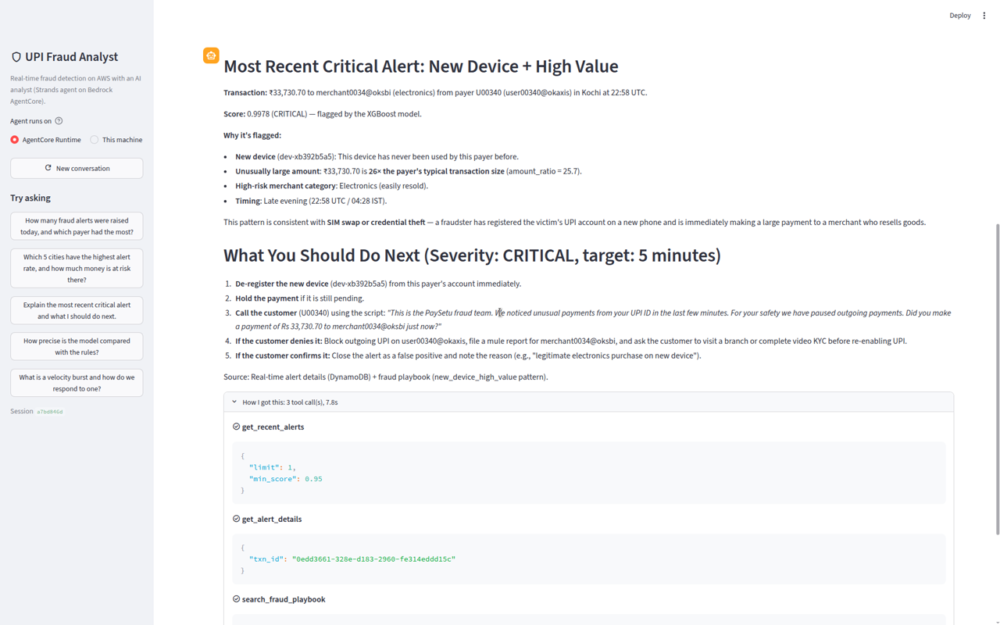
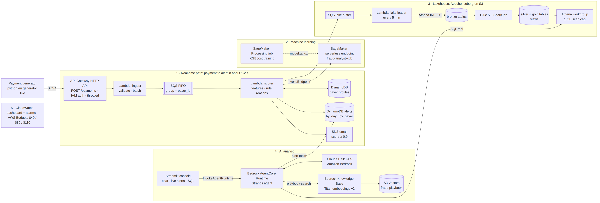
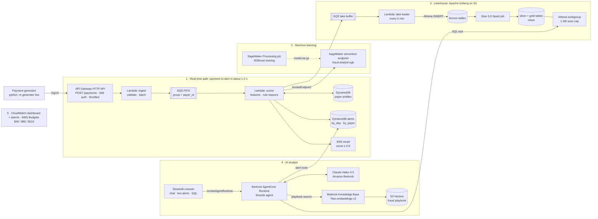
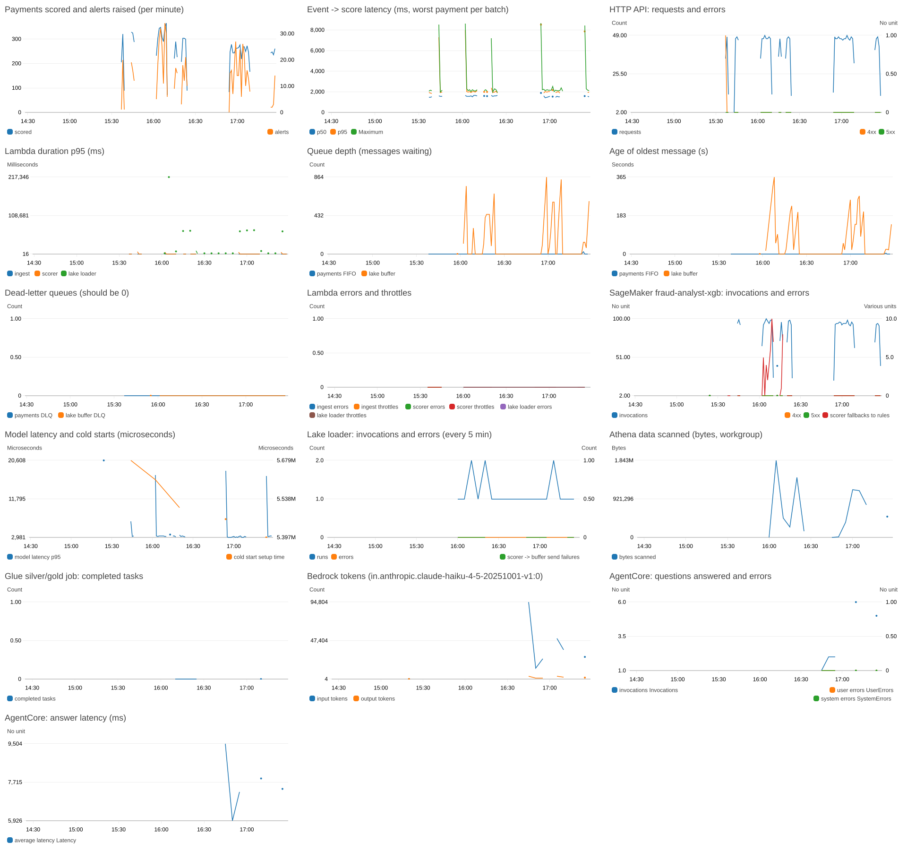
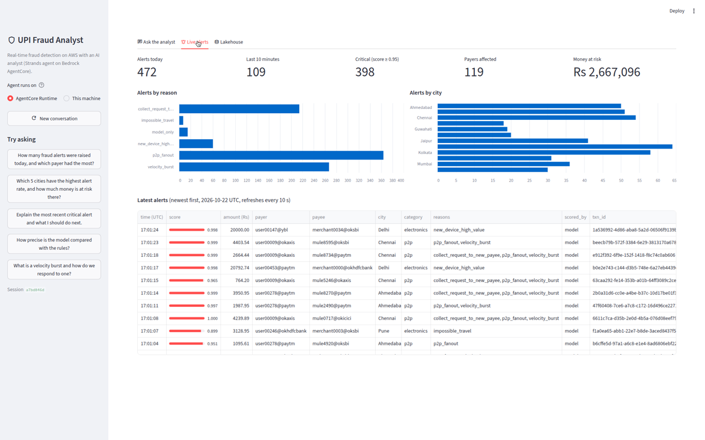
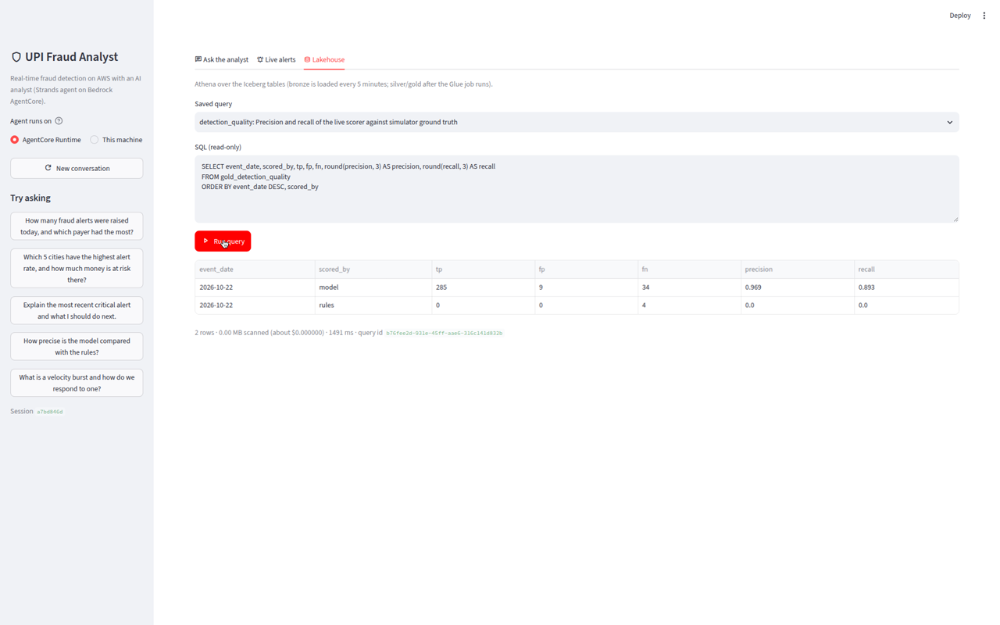

# Real-Time Fraud Detection with an AI Analyst

A serverless, real-time UPI-style payment fraud detection pipeline on AWS. Payments are scored by
an XGBoost model in about 1-2 seconds, alerts land in DynamoDB and your inbox, every event flows
into an **Apache Iceberg lakehouse**, and an **AI fraud analyst** (a Strands agent running Claude
on Amazon Bedrock AgentCore) answers questions about it in plain English. Everything is Python,
and the infrastructure is AWS CDK (Python).



## Highlights

Measured on the live deployment on Oct 22, 2026:

| | Result |
| --- | --- |
| Payments through the full pipeline | 9,926 (simulated UPI traffic, 2% fraud) |
| Event → score latency (generator to DynamoDB) | **p50 1.2 s, p95 1.9 s** |
| Model quality on live traffic vs simulator ground truth | **precision 0.981, recall 0.907** (575 TP, 11 FP, 59 FN) |
| Model quality offline (100k held-out payments) | precision 0.951, recall 0.918, F1 0.935, ROC AUC 0.999; the rules baseline gets F1 0.750 |
| AI analyst answer-quality evals | **5/5** on the deployed runtime, 2-13 s per answer |
| Always-on infrastructure | none: every component is serverless or pay-per-request |
| Total AWS cost of building it | **about $0.60** (see [Cost](#cost)) |

## Architecture



<details>
<summary>Mermaid source (renders on GitHub)</summary>



</details>

The source is [`docs/architecture.mmd`](docs/architecture.mmd); the PNG is exported with
mermaid-cli (see [`docs/learn/06-polish.md`](docs/learn/06-polish.md#the-architecture-diagram)).

### How it works

1. **Real-time path.** The generator simulates UPI payments from 500 payers, including three
   labelled fraud patterns: velocity bursts to mule accounts, a new device paying a high amount,
   and a payment from a city over 1,000 km away minutes after one at home. It signs
   each batch with SigV4 and posts it to an **API Gateway HTTP API**. An **ingest Lambda**
   validates the payments and puts them on an **SQS FIFO** queue, with the payer id as the
   message group so each payer's payments are scored in order.
2. **Scoring.** The **scorer Lambda** updates the payer's rolling profile in DynamoDB (velocity,
   new device, new city, amount vs. usual), builds 15 features, and calls the **SageMaker
   serverless endpoint** (XGBoost). Rules explain each alert ("why was this flagged?") and are
   the fallback if the endpoint fails. Alerts go to a DynamoDB table, and alerts with a score of
   0.9 or more are emailed through **SNS**.
3. **Lakehouse.** Every scored payment also goes to an SQS buffer. A **loader Lambda** runs every
   5 minutes and writes the buffer to **Iceberg bronze tables** with Athena `INSERT INTO`. A **Glue
   Spark job** builds the cleaned silver tables and the daily gold aggregates. **Athena** views sit
   on top.
4. **AI analyst.** A **Strands** agent runs on **Bedrock AgentCore Runtime**, one microVM per
   conversation. It uses **Claude Haiku 4.5** and has 7 tools: read-only Athena SQL, DynamoDB
   alert lookups and summaries, and a search over a fraud playbook stored in a **Bedrock Knowledge
   Base** backed by **S3 Vectors**. A **Streamlit** console has a chat tab (with a "How I got
   this" tool trace), a live alerts view and a SQL tab.
5. **Operations.** A CloudWatch dashboard follows a payment through every stage. Four alarms
   (dead-letter queues, scorer errors, model fallbacks) email an ops topic, and AWS Budgets alerts
   fire at $40, $80 and $110.



| Live alerts | Lakehouse (Athena) |
| --- | --- |
|  |  |

### Tech stack

| Area | Services and libraries |
| --- | --- |
| Ingestion and streaming | API Gateway HTTP API (IAM auth), Lambda (Python 3.12, arm64), SQS FIFO and standard queues with DLQs |
| State and alerts | DynamoDB on-demand (payer profiles, alerts with GSIs and TTL), SNS email |
| Machine learning | XGBoost 1.7, SageMaker Processing (training), SageMaker serverless inference |
| Lakehouse | S3, Apache Iceberg, Glue Data Catalog, Glue 5.0 (Spark), Athena (engine v3, workgroup scan cap) |
| AI analyst | Amazon Bedrock (Claude Haiku 4.5, Titan Text Embeddings v2), Bedrock AgentCore Runtime, Bedrock Knowledge Bases, S3 Vectors, Strands Agents, Streamlit |
| Operations | CloudWatch dashboards, alarms, embedded metric format, AWS Budgets, Cost Explorer |
| Infrastructure and tests | AWS CDK v2 (Python), pytest, moto, CDK assertions, GitHub Actions |

### Repository layout

```
generator/        simulated UPI payments with labelled fraud patterns (batch files or live traffic)
src/ingest/       ingest Lambda
src/scorer/       scorer Lambda: features, rules, model call, alerts
src/lake_loader/  loader Lambda: SQS buffer -> Iceberg bronze via Athena
src/glue_jobs/    Glue Spark job: bronze -> silver -> gold
src/analyst/      the AI analyst: tools, system prompt, AgentCore entrypoint
src/common/       shared feature code and the Athena client
ml/               training data, the SageMaker training job and endpoint checks
lakehouse/        CLI: run the loader and Glue job, create views, run saved queries
agent/            CLI: package and deploy the agent, index the playbook, ask questions, run evals
kb/               the fraud playbook documents the knowledge base indexes
ui/               Streamlit console
infra/            CDK app: one stack per phase, plus monitoring
scripts/          cost report, dashboard snapshot, teardown
docs/learn/       a beginner-friendly guide for each phase
tests/            pytest: unit tests, moto-backed handler tests, CDK assertion tests
```

## Deploy it

**New to this? Follow [`docs/how-to-run.md`](docs/how-to-run.md).** It's a step-by-step guide for
your own laptop (Windows, macOS or Linux): installing the tools, `aws configure`, deploying, running
the generator and the console, asking the agent, checking costs, and teardown.

You need Python 3.12, Node.js 22+ with the AWS CDK CLI (`npm install -g aws-cdk`), the AWS CLI v2
with credentials for an admin IAM user, and Bedrock access to Claude Haiku 4.5 and Titan Text
Embeddings v2 in your region. On macOS, also `brew install libomp` (for xgboost). The quickstart
for macOS/Linux (the Windows PowerShell equivalents are in the guide):

```bash
python3.12 -m venv .venv && source .venv/bin/activate   # Windows: py -3.12 -m venv .venv; .venv\Scripts\Activate.ps1
pip install -r requirements-dev.txt
python -m pytest -q                                   # 82 tests, no AWS calls

cdk bootstrap                                         # once per account and region

# Phases 1-4: infrastructure, then a model
cdk deploy FraudFoundation FraudMl FraudLakehouse FraudStreaming -c alertEmail=you@example.com
python -m ml.pipeline build-data                      # training data -> S3
python -m ml.pipeline train                           # ~5 min; writes ml/latest_model.json
cdk deploy FraudMl FraudStreaming                     # serverless endpoint + model scorer

# Phases 5-6: the AI analyst and monitoring
python -m agent package                               # build/analyst_runtime.zip (~30 MB)
cdk deploy FraudAnalyst FraudMonitoring
python -m agent ingest-kb                             # index the playbook

# Traffic, the console, and the lakehouse
python -m generator --fraud-rate 0.02 live --duration 300
streamlit run ui/app.py                               # http://localhost:8501 (in a second terminal)
python -m lakehouse load && python -m lakehouse glue && python -m lakehouse views
```

Then confirm the two SNS subscription emails (fraud alerts and ops alarms). Until you click the
links, no email is delivered.

**Redeploying from a fresh clone** of an account that's already deployed: run
`python -m ml.pipeline use-latest` and `python -m agent package` before any `cdk deploy`.
`ml/latest_model.json` and `build/analyst_runtime.zip` are git-ignored. Without them, CDK would
remove the SageMaker endpoint and the AgentCore runtime; `cdk deploy` warns when either is missing.

## Demo script (5 minutes)

1. **The architecture (30 s).** Walk the diagram: a payment goes left to right, scored in about
   a second, then lands in the lakehouse, and the analyst reads all of it.
2. **Start traffic (15 s).** `python -m generator --fraud-rate 0.02 live --duration 300` and
   `streamlit run ui/app.py`.
3. **Live alerts (1 min).** Open the *Live alerts* tab. It refreshes every 10 s: alerts today
   and in the last 10 minutes, critical alerts, money at risk, alerts by reason and by city, and
   the newest alerts. Point out the `scored_by = model` column and the reasons, which explain why
   each alert fired. Show an alert email in the inbox.
4. **Ask the analyst (2 min).**
   - "How many fraud alerts were raised today, and which payer had the most?" Open **How I got
     this** to show the tool calls (an alert summary, then the payer's alerts).
   - Follow up: "For that payer, show their latest 3 alerts and tell me whether to block them."
     The agent remembers which payer you meant (same session) and quotes the playbook.
   - "How well is the model doing against ground truth?" It writes and runs Athena SQL on the
     silver table.
5. **Lakehouse (1 min).** In the *Lakehouse* tab run `detection_quality`, then show an Iceberg
   snapshot with `SELECT * FROM "bronze_payments$snapshots"` and time travel with
   `FOR TIMESTAMP AS OF`.
6. **Operations (30 s).** Show the `fraud-analyst` CloudWatch dashboard and the Budgets alerts.
   Close with the cost: well under a dollar, and nothing runs when idle.

## Cost

Building, testing and demoing all six phases cost **about $0.60** of AWS usage, covered by Free
plan credits.

**Cost Explorer (Oct 1-22, 2026, before credits)**, from `python scripts/cost_report.py`:

| Scope | Cost |
| --- | ---: |
| This project (project region + global services) | $0.00 so far: Cost Explorer lags up to 24 h, and the project's usage is from Oct 22 |
| Not this project: an EC2 instance in us-east-1 that existed before the project (EC2, VPC, EBS, S3) | $5.17 |
| Free plan credits remaining | $174.73 (plan expires Oct 30, 2026) |

**Usage-based estimate** (CloudWatch usage metrics × list prices):

| Item | Usage | Cost |
| --- | --- | ---: |
| Claude Haiku 4.5 (the analyst: development, evals and demos) | 246k input, 13k output tokens | $0.31 |
| Claude Sonnet 4.6 (a one-time comparison against Haiku) | 21k input, 2k output tokens | $0.10 |
| Glue 5.0 job (4 runs) | 0.21 DPU-hours | $0.09 |
| DynamoDB on-demand | payer profile and alert reads and writes for about 10k payments | $0.02 |
| SageMaker serverless inference | 3,675 calls | $0.02 |
| SageMaker Processing (training) | 144 s on ml.t3.large | $0.01 |
| Athena | loader inserts and analyst/UI queries, mostly at the 10 MB minimum | $0.01 |
| Titan embeddings, S3 Vectors, AgentCore Runtime | small | < $0.01 |
| Lambda, SQS, API Gateway, SNS, S3, CloudWatch | within free tier | $0.00 |
| **Total** | | **≈ $0.60** |

Run `python scripts/cost_report.py` a day after any activity for the Cost Explorer view by
service and region, with daily totals and the Free plan credit balance.

**Idle cost: about $0.01/day.** There's nothing always-on: no Kinesis shards, no MSK, no
OpenSearch, no provisioned endpoints, no EMR. The SageMaker endpoint is serverless, and AgentCore,
the Knowledge Base and S3 Vectors charge per request. What remains is a few MB of S3 and DynamoDB
storage, log storage, and the loader Lambda's 5-minute poll, which stays within the free tier.
CloudWatch custom metrics are billed only for hours they receive data, and the dashboard and the 4
alarms fit in the free tier.

## About the live deployment

The reference deployment runs in an AWS account on the **AWS Free plan**, which expires on
**October 30, 2026**. The account closes then, so **the live stack won't exist after that date**.
The screenshots and numbers above were captured before then. Everything can be redeployed to any
AWS account with the steps in [Deploy it](#deploy-it).

The Free plan doesn't allow Kinesis Data Streams or Amazon Data Firehose, so this build uses
SQS FIFO and a scheduled loader Lambda in their place. See
[`docs/production-version.md`](docs/production-version.md) for where Kinesis/MSK and Firehose
would slot in for a production system, and why.

## Teardown

```bash
python scripts/teardown.py --dry-run     # list the stacks and leftover log groups
python scripts/teardown.py               # cdk destroy --all, then delete leftover log groups
python scripts/teardown.py --bootstrap --shared-logs   # also remove CDKToolkit and shared log groups
```

`cdk destroy --all` removes every stack. Buckets are emptied automatically, and the Glue database
goes with its tables. The script then deletes the log groups that AWS services create on first
use, outside CloudFormation (the SageMaker endpoint and AgentCore runtime logs, and the CDK
helper Lambdas). `--bootstrap` also deletes the `CDKToolkit` stack, then its retained asset
bucket (all object versions) and container repository. The budget is part of `FraudFoundation`
and is deleted with it.

## Learning guides

Start with [How to run this project](docs/how-to-run.md). Then, one guide per phase:

1. [Foundation](docs/learn/01-foundation.md): the CDK app, budgets, S3 buckets, the Glue database, and the payment generator
2. [Streaming](docs/learn/02-streaming.md): API Gateway, an ingest Lambda, SQS FIFO, a scorer Lambda, DynamoDB, and SNS
3. [Machine learning](docs/learn/03-ml.md): XGBoost trained on SageMaker and served from a serverless endpoint
4. [Lakehouse](docs/learn/04-lakehouse.md): an SQS buffer and loader Lambda into Iceberg bronze tables, Glue silver and gold layers, and Athena views
5. [AI analyst](docs/learn/05-ai-analyst.md): a Strands agent on AgentCore Runtime with Athena, DynamoDB and Knowledge Base tools, plus a Streamlit console
6. [Polish](docs/learn/06-polish.md): the dashboard, alarms, diagram, cost report, CI, and teardown

[Production version](docs/production-version.md): what would change at real scale.

## Resume bullets

- Built a serverless real-time UPI fraud detection pipeline on AWS (API Gateway, Lambda, SQS FIFO,
  DynamoDB, SNS) that scores payments in 1.2 s p50 / 1.9 s p95 from event to alert, defined
  entirely in AWS CDK (Python) with 82 pytest and CDK-assertion tests in CI.
- Trained an XGBoost fraud model on SageMaker and served it from a serverless endpoint with a
  rules fallback, raising F1 from 0.75 (rules) to 0.935 offline. On live traffic it reached
  precision 0.981 and recall 0.907.
- Designed an Apache Iceberg lakehouse (bronze/silver/gold) on S3 with Glue Spark and Athena,
  fed by a micro-batch Lambda loader, with time travel, schema-on-read views and
  ground-truth quality metrics.
- Shipped an AI fraud analyst: a Strands agent on Bedrock AgentCore Runtime (Claude Haiku 4.5)
  with read-only Athena SQL, DynamoDB and RAG (Bedrock Knowledge Bases on S3 Vectors) tools, a
  Streamlit console with tool traces, and answer-quality evals that pass 5/5.
- Kept the whole build at about $0.60 of AWS usage, with about $0.01/day idle, by choosing
  pay-per-request services, plus CloudWatch dashboards, alarms and budget alerts.

## License

MIT
