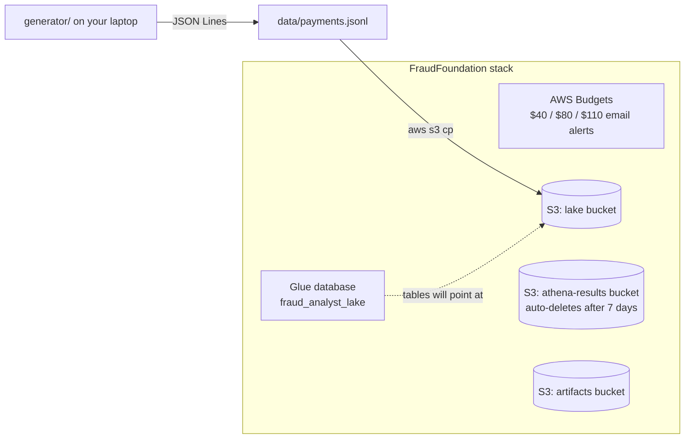

# Phase 1: Foundation (CDK app, budgets, buckets, Glue database, payment generator)

This phase builds the ground floor that every later phase sits on. Nothing here
processes payments yet. It gives us:

1. **A safety net for money**: AWS Budgets emails you when total spend passes $40, $80 and $110.
2. **Storage**: three S3 buckets (the data lake, Athena query results, build artifacts).
3. **A catalog**: an empty Glue database, `fraud_analyst_lake`, that will hold our lakehouse tables.
4. **Fake but realistic data**: a Python simulator that produces UPI-style payments with fraud mixed in.

## Why this order?

- Budgets come **first** because the AWS credit is limited ($134). An alert costs nothing and
  protects you if you forget to tear something down.
- Buckets and the Glue database are shared by several later stacks (streaming, ML, lakehouse,
  agent), so they live in one long-lived "foundation" stack.
- The generator lets us test everything without real customer data, and because it labels its own fraud,
  we can later measure how good our detector is.

## What was built



| Resource | Name | Used later for |
| --- | --- | --- |
| Budget | `fraud-analyst-total-spend` | Emails at $40/$80/$110 actual spend |
| S3 bucket | `fraud-analyst-lake-<account>-<region>` | Bronze/silver/gold Iceberg tables (phase 4) |
| S3 bucket | `fraud-analyst-athena-results-<account>-<region>` | Athena query output (phase 4, 5) |
| S3 bucket | `fraud-analyst-artifacts-<account>-<region>` | ML model files, Glue scripts, agent code, KB docs |
| Glue database | `fraud_analyst_lake` | Table definitions for Athena and Glue |

Code: [`infra/stacks/foundation_stack.py`](../../infra/stacks/foundation_stack.py),
[`generator/simulator.py`](../../generator/simulator.py).

## The AWS services, explained

### AWS CDK (Cloud Development Kit)
Infrastructure as code. Instead of clicking around the console, we describe resources
in Python (`infra/`). `cdk synth` turns that Python into a **CloudFormation template**
(a big JSON/YAML file), and `cdk deploy` asks CloudFormation to create the resources.
Benefits: repeatable, reviewable in a PR, and `cdk destroy` removes everything cleanly.

- `cdk.json` tells the CDK CLI how to run the app (`python3 -m infra.app`) and holds
  **context values**, which are settings like `alertEmail`. You can override them per deploy:
  `cdk deploy -c alertEmail=someone@example.com`.
- `cdk bootstrap` (one time per account and region) creates a `CDKToolkit` stack with a
  staging bucket and IAM roles that CDK uses to upload Lambda code and other assets.

### AWS CloudFormation
The AWS engine that actually creates, updates and deletes resources as a group called a **stack**.
If anything fails mid-deploy, it rolls back. Each `Stack` class in `infra/stacks/` becomes one
CloudFormation stack (this phase: `FraudFoundation`).

### AWS Budgets
Tracks your spend and sends alerts. Our budget:
- is **annual** (calendar year-to-date), so the running total does not reset on the 1st of
  the month in the middle of the project;
- has **`IncludeCredit = false`**. This matters: by default, Budgets subtracts promotional credits,
  so your "spend" would look like $0 and no alert would ever fire. We want to know how much of the
  $134 credit is being burned;
- emails `sahilcsgo69@gmail.com` (the `alertEmail` context value). Budget emails need **no**
  confirmation click. (The SNS fraud-alert email in phase 2 **does**, so watch for it then.)

Budgets data refreshes a few times a day, so alerts can lag spend by up to ~8 hours.
The first two budgets in an account are free.

### Amazon S3 (Simple Storage Service)
Object storage: files ("objects") in "buckets". Bucket names are global across all of AWS,
which is why ours include the account ID and region. All three buckets:
- block all public access, use S3-managed encryption, and reject non-HTTPS requests;
- use `RemovalPolicy.DESTROY` + `auto_delete_objects=True`, so `cdk destroy` empties and deletes them.
  (CDK adds a tiny helper Lambda for the emptying; it only runs during deploy and destroy.)
- The Athena results bucket has a **lifecycle rule** that deletes objects after 7 days, because query results
  pile up and we never need old ones.

### AWS Glue Data Catalog
A metadata store: "table X has these columns and its files live at s3://...". It stores
no data itself. Athena, Glue Spark jobs, and Firehose all read table definitions from it.
A **database** is just a namespace for tables. We created `fraud_analyst_lake`; phase 4 adds
the `bronze_*`, `silver_*`, and `gold_*` Iceberg tables to it.

## The payment generator

`python -m generator` simulates a small UPI ecosystem:
- 500 users, each with a home city (12 Indian cities), 1–2 phones, and a typical spend (about ₹450 median);
- 120 merchants across categories (grocery, food delivery, fuel, electronics, jewellery, ...), plus P2P transfers;
- a stream of events in timestamp order. Each event is one JSON object:

```json
{"txn_id": "6ea5e341-...", "event_time": "2026-10-22T14:57:05.754Z", "event_ts_ms": 1792681025754,
 "payer_id": "U00190", "payer_vpa": "user00190@okhdfcbank", "payee_vpa": "merchant0056@ybl",
 "payee_type": "MERCHANT", "merchant_id": "M0056", "merchant_category": "food_delivery",
 "amount": 393.45, "currency": "INR", "channel": "UPI_INTENT", "device_id": "dev-0000228",
 "device_os": "android", "ip_address": "68.207.195.51", "city": "Mumbai", "lat": 19.04, "lon": 72.92,
 "label_is_fraud": false, "label_pattern": "none"}
```

Three fraud patterns are injected (about 2–4% of events):

| Pattern | What it looks like | Real-world analogue |
| --- | --- | --- |
| `velocity_burst` | 6–12 P2P payments to "mule" accounts within about a minute | Account takeover draining funds |
| `new_device_high_value` | Never-seen device, amount 15–60× normal (≥ ₹20,000), electronics/jewellery | SIM swap or stolen credentials |
| `geo_jump` | Payment from a city >1000 km away a few minutes after a payment at home | Cloned credentials used elsewhere |

There's also **legitimate noise** (occasional new phones, occasional big purchases) so the
ML model in phase 3 can't just learn "new device = fraud".

`label_is_fraud` and `label_pattern` are **ground truth from the simulator**. Real payment
systems never get labels at payment time. Our scorer ignores them; we only use them to train the
model and to measure precision and recall.

## Cost of this phase

| Item | Cost |
| --- | --- |
| Budgets (1 budget) | $0 (first two budgets are free) |
| S3 (a few MB) | < $0.01 / month |
| Glue database | $0 (first million catalog objects free) |
| CDK bootstrap bucket / roles | < $0.01 / month |

**Idle cost: about $0/day.** Safe to leave deployed for the whole project.

## Try it yourself

### One-time setup on your laptop

Everything runs in **Asia Pacific (Mumbai)**, region code `ap-south-1`. <!-- pragma: allowlist secret -->

```bash
# Tools: Python 3.12+, Node.js 18+, AWS CLI v2
npm install -g aws-cdk
aws configure            # access key, secret, and the Mumbai region code (see above)
aws sts get-caller-identity

git clone https://github.com/SahilTalathi142001/Real-Time-Fraud-Detection-with-an-AI-Analyst.git
cd Real-Time-Fraud-Detection-with-an-AI-Analyst
python3 -m venv .venv && source .venv/bin/activate
pip install -r requirements-dev.txt
```

### Run the tests (no AWS needed)

```bash
python -m pytest -q
```

`tests/test_generator.py` checks the generator (schema, ordering, reproducibility, each fraud
pattern), and `tests/test_foundation_stack.py` uses **CDK assertions** to check the synthesized
CloudFormation (e.g. "the budget has thresholds 40/80/110 and excludes credits").

### Deploy

```bash
ACCOUNT=$(aws sts get-caller-identity --query Account --output text)
REGION=$(aws configure get region)
cdk bootstrap aws://$ACCOUNT/$REGION     # once per account and region
cdk synth FraudFoundation                        # optional: view the generated CloudFormation
cdk deploy FraudFoundation
```

### Verify

```bash
ACCOUNT=$(aws sts get-caller-identity --query Account --output text)
REGION=$(aws configure get region)

# Budget and its thresholds
aws budgets describe-budgets --account-id $ACCOUNT \
  --query 'Budgets[].{name:BudgetName,limit:BudgetLimit.Amount,actual:CalculatedSpend.ActualSpend.Amount}'
aws budgets describe-notifications-for-budget --account-id $ACCOUNT \
  --budget-name fraud-analyst-total-spend --query 'Notifications[].Threshold'

# Buckets and Glue database
aws s3 ls | grep fraud-analyst
aws glue get-database --name fraud_analyst_lake

# Generate 5,000 payments and upload them
python -m generator --seed 42 file --count 5000 --out data/payments.jsonl
aws s3 cp data/payments.jsonl s3://fraud-analyst-lake-$ACCOUNT-$REGION/samples/payments.jsonl

# Peek at a few events
python -m generator --seed 1 stdout --count 3
```

Expected generator output (counts vary by seed):
```
Wrote 5000 events to data/payments.jsonl (132 fraud, 2.6%)
  geo_jump                4
  new_device_high_value   18
  none                    4868
  velocity_burst          110
```

## What to look at in the AWS console

- **CloudFormation → Stacks → FraudFoundation**: the *Resources* tab lists everything CDK made;
  the *Outputs* tab shows the bucket names; *Template* shows the generated JSON.
- **Billing and Cost Management → Budgets → fraud-analyst-total-spend**: the thresholds and
  current spend. Check *Budget scope* and confirm credits are excluded.
- **S3**: open the lake bucket and find `samples/payments.jsonl`. Select it, then choose
  *Actions → Query with S3 Select* to peek at rows.
- **AWS Glue → Data Catalog → Databases → fraud_analyst_lake**: empty for now.
- **Billing → Cost Explorer**: group by *Service* to see where money goes (data lags ~24h).

## Teardown

```bash
cdk destroy FraudFoundation
```

Leave it up for now; it costs nothing at idle and later stacks depend on it.
