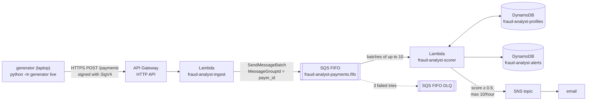

# Phase 2: The real-time streaming path

This phase makes the system *do* something. Payments are sent to an HTTPS API, queued,
scored for fraud within about 1.5 seconds, and suspicious ones land in an alerts table. The worst
ones also trigger an email.

> **Action for Sahil:** AWS sent a *"AWS Notification - Subscription Confirmation"* email to
> `sahilcsgo69@gmail.com`. **Click "Confirm subscription"** in it, or you'll never receive
> fraud-alert emails. (It may be in Spam/Promotions.) Check the status with the command in
> [Verify](#verify).

## What was built



Code: [`infra/stacks/streaming_stack.py`](../../infra/stacks/streaming_stack.py),
[`src/ingest/handler.py`](../../src/ingest/handler.py),
[`src/scorer/handler.py`](../../src/scorer/handler.py),
[`src/common/features.py`](../../src/common/features.py),
[`src/common/rules.py`](../../src/common/rules.py).

### Why SQS FIFO and not Kinesis?

The original plan used **Kinesis Data Streams**, the usual AWS choice for event streams.
This AWS account is on the **Free plan**, which doesn't allow Kinesis (the API answers
`SubscriptionRequiredException`). **SQS FIFO** is allowed, and with one setting it gives the
property that matters here:

- `MessageGroupId = payer_id`: messages in the same group are delivered **in order, one batch
  at a time**. So one payer's payments are always scored in the order they happened, which the
  velocity features ("how many payments in the last minute?") depend on. Different payers are
  processed in parallel. It's the same guarantee a Kinesis partition key gives.
- `MessageDeduplicationId = txn_id`: if the generator retries a request, SQS drops the duplicate
  (within 5 minutes), so a payment isn't scored twice.

See [`docs/production-version.md`](../production-version.md) for where Kinesis or MSK would replace this in a
real deployment, and why.

## Data flow, step by step

1. **Generator → API Gateway.** `python -m generator live` simulates payments in real time and
   POSTs them in batches of up to 25. Each request is **signed with AWS Signature V4** using your
   AWS credentials, because the API uses **IAM authorization**. Anyone without credentials gets `403`.
   The stage is throttled to 20 requests/s (burst 50), which caps how much traffic (and cost)
   anyone could push.
2. **Ingest Lambda** validates each payment (required fields, types, positive amount), rejects
   bad ones with a reason, and sends good ones to the FIFO queue in batches of 10 (the SQS maximum).
3. **Scorer Lambda** is triggered by SQS with up to 10 messages per batch, up to 5 copies running in parallel.
   For each batch it:
   1. loads each payer's **profile** from DynamoDB (`fraud-analyst-profiles`): number of payments, average amount,
      known devices and payees, last location and time, and timestamps from the last 10 minutes;
   2. computes **15 features** per payment (`src/common/features.py`): amount vs. usual, new device?,
      new payee?, payments in the last 1 and 10 minutes, km from the last payment and implied speed,
      hour of day (IST), collect request?, P2P?, category risk, ...;
   3. scores with **hand-written rules** (`src/common/rules.py`). Phase 3 swaps in an ML model;
   4. saves updated profiles, writes payments scoring ≥ 0.6 to `fraud-analyst-alerts` with the
      reasons, and emails the most severe (≥ 0.9) through SNS, at most once per payer per batch
      and **10 emails per hour** (an atomic counter in DynamoDB), so a demo can't flood your inbox;
   5. writes **CloudWatch metrics** using the *Embedded Metric Format*: a specially shaped JSON
      log line that CloudWatch turns into metrics, with no extra API calls.
4. If a batch fails 3 times, its messages go to the **dead-letter queue** (DLQ) for inspection
   instead of blocking the queue forever.

### The rules

| Rule | Fires when | Adds |
| --- | --- | --- |
| velocity_burst | ≥ 4 payments in the previous minute | 0.5–0.8 |
| new_device_high_value | unseen device and amount ≥ 8× usual | 0.7 |
| unusually_high_amount | amount ≥ 15× usual (known device) | 0.3 |
| impossible_travel | ≥ 500 km from the last payment at ≥ 300 km/h | 0.7 |
| collect_request_to_new_payee | UPI collect request to a never-seen payee | 0.15 |
| p2p_fanout | P2P to a new payee after ≥ 3 payments in 10 min | 0.15 |

Offline, on 50k simulated payments, the rules get **precision 0.82, recall 0.69**. They miss the
first few payments of every burst, and they flag the *real* customer's next payment after a geo-jump.
Phase 3's model does much better.

## The AWS services, explained

### Amazon API Gateway (HTTP API)
A managed HTTPS front door. An **HTTP API** is the newer, cheaper flavour (vs. REST API):
$1.00 per million requests in Mumbai. We use:
- a **route** `POST /payments` with a **Lambda proxy integration**, so the whole HTTP request is handed to the ingest Lambda;
- the **IAM authorizer**, so callers must sign requests with AWS credentials that are allowed `execute-api:Invoke`;
- **stage throttling** (`$default` stage: 20 req/s, burst 50).

### AWS Lambda
Runs your code on demand; you pay per request and per GB-second of run time. Both functions
use **Python 3.12 on ARM64 (Graviton)**, which costs about 20% less than x86. The code is the `src/`
folder, which CDK zips and uploads (that's what `cdk bootstrap` was for). Each function has a
log group with 1-week retention so logs don't pile up.

### Amazon SQS (Simple Queue Service), FIFO queues
A managed message queue. Producers send messages; consumers receive, process, and delete them.
If a consumer crashes, the message reappears after the **visibility timeout** (360 s here, which is 6× the
scorer timeout) and is retried. **FIFO** queues add ordering within a *message group* and
deduplication. We turned on **high-throughput mode** (dedup scope and throughput limit per
message group). **Lambda event source mapping** means Lambda polls the queue for you and invokes
the function with batches. The **DLQ** (also FIFO) catches messages that fail 3 times.

### Amazon DynamoDB
A serverless key-value / document database with millisecond reads and writes. Both tables use
**on-demand** billing (pay per request, $0 when idle) and a **TTL** attribute (`expires_at`), so
DynamoDB deletes old items for free (profiles after 30 days, alerts after 90).
- `fraud-analyst-profiles`: key `payer_id`; the profile is stored as a JSON string.
- `fraud-analyst-alerts`: key `alert_id` (= `txn_id`), with two **global secondary indexes**
  (GSIs, alternate keys you can query by): `by_day` (`alert_day`, `event_ts_ms`) for "latest alerts
  today", and `by_payer` (`payer_id`, `event_ts_ms`) for "all alerts for this payer". The AI analyst
  in phase 5 uses both.

### Amazon SNS (Simple Notification Service)
Pub/sub messaging. The scorer *publishes* to the `fraud-analyst-alerts` topic; the email
*subscription* delivers it. Email subscriptions must be **confirmed** by the recipient, which is
why you need to click the link.

### Amazon CloudWatch (Logs and Metrics)
Every `print()` from a Lambda lands in CloudWatch Logs. Our scorer prints one EMF line per batch,
which creates metrics in the `FraudAnalyst` namespace: `TransactionsScored`, `AlertsRaised`,
`AlertEmailsSent`, `ModelFallbacks`, `EventToScoreLatencyMs`, `BatchDurationMs`. Phase 6 puts
them on a dashboard.

## What we verified (Oct 22, 2026)

| Check | Result |
| --- | --- |
| Unsigned `curl -X POST .../payments` | `HTTP 403` (IAM auth works) |
| `python -m generator --fraud-rate 0.02 live --duration 120` | 613 sent, 613 accepted, 0 rejected |
| Alerts in DynamoDB | 22: 19 velocity_burst, 1 new_device_high_value, 2 false positives |
| Event → scored latency (p50 / p95) | 1.5 s / 1.9 s (includes up to 0.5 s of generator batching) |
| Queue and DLQ after the run | 0 / 0 messages |
| Scorer errors in logs | 0 |
| Alert emails published | 9 (delivered once you confirm the subscription) |

## Cost of this phase

| Item | Price (Mumbai) | Our usage |
| --- | --- | --- |
| API Gateway HTTP API | $1.00 / million requests | ~2.5k requests per 10-minute demo, so < $0.01 |
| Lambda (ARM) | $0.20 / million requests + $0.0000133 / GB-s | a few cents a month |
| SQS FIFO | $0.50 / million requests (first 1M/month free) | Lambda's idle long-polling is ~0.5–1M requests/month; demo traffic is tiny |
| DynamoDB on-demand | ~$1.42 / million writes, $0.28 / million reads | < $0.05 per demo |
| SNS email | first 1,000 emails/month free | ≤ 10/hour by design |
| CloudWatch custom metrics | $0.30 / metric / month, prorated hourly | 6 metrics ≈ $1.80/month if left up |

**Idle cost: about $0.06/day** (mostly the custom metrics; there's nothing like a Kinesis shard billing by the hour).

## Try it yourself

```bash
source .venv/bin/activate
python -m pytest -q tests/test_streaming_stack.py tests/test_lambda_handlers.py tests/test_features_and_rules.py

cdk deploy FraudStreaming

# 1) Anonymous calls are rejected (expect 403)
URL=$(aws cloudformation describe-stacks --stack-name FraudStreaming \
  --query "Stacks[0].Outputs[?OutputKey=='PaymentsApiUrl'].OutputValue" --output text)
curl -s -o /dev/null -w "%{http_code}\n" -X POST -d '{}' "$URL"

# 2) Send live traffic for 2 minutes (fraud-rate 0.02 makes the demo more eventful)
python -m generator --fraud-rate 0.02 live --duration 120

# 3) Look at the newest alerts
aws dynamodb query --table-name fraud-analyst-alerts --index-name by_day \
  --key-condition-expression "alert_day = :d" \
  --expression-attribute-values "{\":d\":{\"S\":\"$(date -u +%F)\"}}" \
  --no-scan-index-forward --max-items 5 \
  --query 'Items[].{payer:payer_vpa.S,amount:amount.N,score:score.N,reasons:reasons.L[].S}'

# 4) Queue depth (should drain to 0) and DLQ (should stay 0)
for q in fraud-analyst-payments.fifo fraud-analyst-payments-dlq.fifo; do
  aws sqs get-queue-attributes --attribute-names ApproximateNumberOfMessages \
    --queue-url $(aws sqs get-queue-url --queue-name $q --query QueueUrl --output text)
done
```

### Verify
```bash
# Is the email subscription confirmed? ("PendingConfirmation" means: click the email link)
TOPIC=$(aws cloudformation describe-stacks --stack-name FraudStreaming \
  --query "Stacks[0].Outputs[?OutputKey=='AlertTopicArn'].OutputValue" --output text)
aws sns list-subscriptions-by-topic --topic-arn $TOPIC --query 'Subscriptions[].[Endpoint,SubscriptionArn]'

# Scorer logs: alerts and the per-batch metrics line
aws logs tail /aws/lambda/fraud-analyst-scorer --since 10m --format short | grep -E 'ALERT|TransactionsScored' | tail
```

## What to look at in the AWS console

- **API Gateway → APIs → fraud-analyst-payments-api**: *Routes* (see the IAM authorizer on
  `POST /payments`), *Stages → $default* (throttling), and *Monitor* (request counts, 4xx/5xx).
- **SQS → fraud-analyst-payments.fifo**: *Monitoring* tab shows messages sent/received/deleted.
  Use *Send and receive messages → Poll for messages* only on the DLQ, since polling the main queue
  steals messages from the scorer.
- **Lambda → fraud-analyst-scorer**: *Configuration → Triggers* shows the SQS trigger (batch
  size 10, max concurrency 5). *Monitor → View CloudWatch logs* shows the `ALERT` lines.
- **DynamoDB → Tables → fraud-analyst-alerts → Explore table items**: open an alert to see
  `reasons`, `features`, and `score`. Try *Query* on the `by_day` index.
- **CloudWatch → Metrics → All metrics → FraudAnalyst → Service**: graph `AlertsRaised` and
  `EventToScoreLatencyMs`.
- **SNS → Topics → fraud-analyst-alerts → Subscriptions**: status should be *Confirmed*.

## Teardown

```bash
cdk destroy FraudStreaming   # tables, queues, API, functions; profiles and alerts are deleted
```
