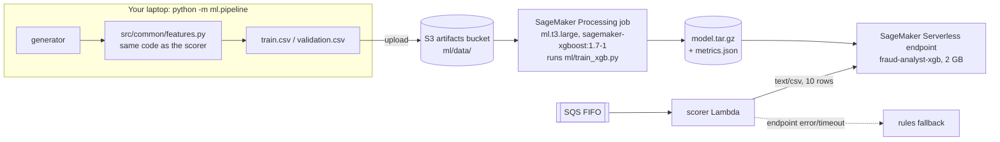

# Phase 3: An ML model (XGBoost on SageMaker, served serverlessly)

Phase 2's rules catch obvious fraud but miss a lot: they only fire after the 4th payment of a
burst, and their thresholds are guesses. This phase trains a gradient-boosted tree model
(**XGBoost**) on SageMaker, serves it from a **serverless endpoint**, and switches the scorer
to it. The rules stay as the *explanation* ("why was this flagged?") and as a **fallback** if
the endpoint is slow or down.

## Results

| | Precision | Recall | F1 |
| --- | --- | --- | --- |
| Rules (phase 2), offline validation set | 0.817 | 0.694 | 0.750 |
| **XGBoost, offline validation set (threshold 0.85)** | **0.951** | **0.918** | **0.935** |
| XGBoost at threshold 0.5 (more recall, more false alarms) | 0.870 | 0.965 | 0.915 |

Validation ROC AUC: **0.999**. The validation set is 100k payments from a *different random seed*
(and a different time) than the 300k training payments.

**Live check (Oct 22, 2026):** 941 payments over 3 minutes produced 47 alerts, all scored by the model.
44 of the 48 injected velocity-burst payments were caught (92%, vs. about 54% with rules alone in phase 2),
and only 2 of the 47 alerts were false positives. Zero fallbacks to rules.

Most important features (by gain): `is_p2p`, `txns_last_1m`, `is_new_device`,
`secs_since_last`, `amount_ratio`, `category_risk`.

## What was built



Code: [`ml/pipeline.py`](../../ml/pipeline.py) (laptop side),
[`ml/train_xgb.py`](../../ml/train_xgb.py) (runs inside SageMaker),
[`ml/dataset.py`](../../ml/dataset.py), [`infra/stacks/ml_stack.py`](../../infra/stacks/ml_stack.py),
and `invoke_model` in [`src/scorer/handler.py`](../../src/scorer/handler.py).

### Key idea: no training/serving skew
The training data is built by replaying the simulator through **exactly the same**
`compute_features` / `update_profile` functions the scorer Lambda uses. A classic ML bug is
computing a feature one way in training and another way in production; sharing the code rules
that out. (At larger scale, a feature store such as SageMaker Feature Store does this job.)

### Why a *Processing* job and not a *Training* job?
SageMaker **Training Jobs** are the usual tool. This account's quota for training instances is 0
(normal for new accounts), and the quota-increase request was declined on the Free plan.
**Processing Jobs** (meant for data prep and evaluation) *are* allowed on `ml.t3` instances, and
a processing job can run any script in any container. So `ml/train_xgb.py` runs in the official
`sagemaker-xgboost:1.7-1` image on `ml.t3.large` and writes the same `model.tar.gz` a training job
would. The script supports both modes: `python -m ml.pipeline train --backend training`
uses a real Training Job in script mode on accounts that have the quota.

## The AWS services, explained

### Amazon SageMaker
AWS's managed ML platform. The parts we use:
- **Processing job:** "run this container with this script on this instance type, give it these
  S3 inputs, upload these outputs, then shut the machine down." Billed per second while it runs
  (about $0.12/hour for `ml.t3.large`; our run billed 144 s, about $0.005).
- **Built-in XGBoost container** (`720646828776.dkr.ecr.<region>.amazonaws.com/sagemaker-xgboost:1.7-1`),
  a Docker image AWS maintains that can train *and* serve XGBoost models. Using it means no Docker
  on your laptop.
- **Model**: a pointer to (container image + `model.tar.gz` in S3 + an IAM role).
- **Endpoint config** with a **serverless** variant (2048 MB memory, max concurrency 5), and an
  **endpoint** named `fraud-analyst-xgb`. Serverless inference starts compute on demand and bills
  per millisecond of inference plus data processed. **Idle cost is $0**, unlike a classic
  real-time endpoint on `ml.m5.large`, which bills about $0.13/hour (about $95/month) even with no traffic.
  The trade-off is **cold starts**: the first request after idle took about 6 s in our test; warm requests take about 50 ms.
- **IAM role** `fraud-analyst-sagemaker`: lets SageMaker read and write `ml/*` in the artifacts bucket,
  pull the container image, and write logs.

### How the scorer calls the model
The scorer sends all 10 payments of a batch in **one** request as CSV (one row per payment,
15 numbers in `FEATURE_NAMES` order) and gets back 10 probabilities. If the endpoint errors or takes
longer than 25 s, the batch is scored by rules and the `ModelFallbacks` metric goes up. Payments
are never dropped. The alert threshold (0.85) is the one that maximized F1 on validation; it's saved
in `ml/latest_model.json` and passed to the Lambda as `ALERT_THRESHOLD`.

### The XGBoost model
Gradient-boosted decision trees: each new small tree corrects the errors of the previous ones.
It's strong on tabular data like ours, fast, and needs no feature scaling. Settings:
`max_depth=6`, `eta=0.1`, up to 300 rounds with **early stopping** on validation AUC-PR (it
stopped at about 80), and `scale_pos_weight = sqrt(neg/pos)` to boost the rare fraud class without
ruining precision.

## Cost of this phase

| Item | Cost |
| --- | --- |
| Processing job (ml.t3.large, 144 s billed) | ~$0.005 per training run |
| Serverless endpoint, idle | $0 |
| Serverless inference, 2 GB | ~$0.00004 per second of compute; a 10-minute demo is well under $0.05 |
| S3 for data and model (~40 MB) | < $0.01/month |

**Idle cost: $0/day.**

## Try it yourself

```bash
source .venv/bin/activate
pip install -r requirements-dev.txt        # includes xgboost-cpu for the local training test
python -m pytest -q tests/test_ml.py

cdk deploy FraudMl                          # first time: just the IAM role (no model yet)
python -m ml.pipeline build-data            # 300k train + 100k validation rows -> S3, prints the rules baseline
python -m ml.pipeline train                 # ~5 min; prints AUC/precision/recall; writes ml/latest_model.json
cdk deploy FraudMl FraudStreaming           # creates the endpoint and points the scorer at it
python -m ml.pipeline invoke                # 5 fraud + 5 normal rows -> scores

# End to end: model-scored alerts
python -m generator --fraud-rate 0.02 live --duration 180
aws dynamodb scan --table-name fraud-analyst-alerts --select COUNT \
  --filter-expression "scored_by = :m" --expression-attribute-values '{":m":{"S":"model"}}'
```

Expected `invoke` output (warm endpoint):
```
Endpoint answered in 0.85s
  label=FRAUD  score=0.9189
  label=FRAUD  score=0.9830
  label=ok     score=0.0001
  ...
```
Some fraud rows score low. They're the *first* payments of a burst, which look normal on their own.

Want to train on your laptop instead? `python ml/train_xgb.py --train data/ml/train --validation data/ml/validation --model-dir /tmp/model`

## What to look at in the AWS console

- **SageMaker → Processing → Processing jobs → fraud-xgb-...**: instance type, duration, inputs and outputs.
  *View logs* shows the training log (AUC per round and the final metrics JSON).
- **SageMaker → Inference → Endpoints → fraud-analyst-xgb**: status *InService*, the serverless
  config, and *Monitor* graphs (`Invocations`, `ModelLatency`, `ModelSetupTime` is the cold start).
- **S3 → artifacts bucket → ml/**: `data/`, `code/`, `output/<job>/model.tar.gz`, `metrics.json`.
- **Lambda → fraud-analyst-scorer → Configuration → Environment variables**: `MODEL_ENDPOINT`
  and `ALERT_THRESHOLD`.
- **CloudWatch → Metrics → FraudAnalyst**: `ModelFallbacks` should stay at 0.

## Teardown

```bash
cdk destroy FraudMl     # deletes the endpoint, model and role (the scorer falls back to rules)
```
