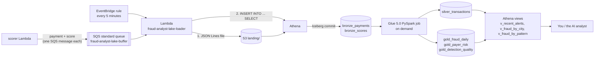

# Phase 4: The Iceberg lakehouse (bronze → silver → gold, queried with Athena)

Phases 2–3 answer "is *this* payment fraud?" in real time. A fraud team also needs history:
"which cities have the most fraud this week?", "is the model still precise?", "show me this
payer's last 50 payments". That needs every payment and every score stored cheaply and
queryable with SQL. This phase builds a **lakehouse**: files in S3 in the **Apache Iceberg**
table format, catalogued in **Glue**, transformed by **Glue Spark**, and queried by **Athena**.

## What was built



Code: [`infra/stacks/lakehouse_stack.py`](../../infra/stacks/lakehouse_stack.py),
[`src/lake_loader/handler.py`](../../src/lake_loader/handler.py),
[`src/glue_jobs/silver_gold.py`](../../src/glue_jobs/silver_gold.py),
[`src/common/athena.py`](../../src/common/athena.py), [`lakehouse/`](../../lakehouse/) (CLI and views).

### The medallion layers

| Layer | Tables | What's in it | Who writes it |
| --- | --- | --- | --- |
| **Bronze** (raw) | `bronze_payments`, `bronze_scores` | exactly what arrived, append-only, may contain duplicates | the loader Lambda, every 5 min |
| **Silver** (clean) | `silver_transactions` | one row per payment (deduplicated by `txn_id`), proper timestamp types, joined with its score, `event_date` partition | Glue job |
| **Gold** (business) | `gold_fraud_daily`, `gold_payer_risk`, `gold_detection_quality` | aggregates an analyst or a dashboard wants | Glue job |
| Views | `v_recent_alerts`, `v_fraud_by_city`, `v_fraud_by_pattern` | saved SQL over silver/gold | `python -m lakehouse views` |

### Why a loader Lambda instead of Firehose?
**Amazon Data Firehose** can write straight into Iceberg tables and is the normal choice. This
account's **Free plan doesn't allow Firehose**, so we built the same behaviour from allowed parts.
1. The scorer sends each scored payment to a standard SQS queue (the **buffer**).
2. Every 5 minutes, EventBridge triggers the **loader**. It drains up to 60 s of messages and writes
   them as one JSON Lines file per table to `s3://<lake>/landing/<kind>/<run_id>.json`.
3. It runs `INSERT INTO bronze_payments (...) SELECT ... FROM landing_payments WHERE "$path" = '<that file>'`.
   `landing_payments` is a plain JSON table over the landing folder; `"$path"` is an Athena
   pseudo-column holding each row's source file, so only the new file is read. Each insert is one
   **Iceberg commit (snapshot)**.
4. It moves the landing file to `archive/` and only then **deletes the SQS messages**. If any
   step fails, the messages reappear after the 15-minute visibility timeout and the next run
   retries them. That's *at-least-once* delivery; duplicates are removed in silver.

[`docs/production-version.md`](../production-version.md) explains when Firehose is the better
choice.

## The AWS services and concepts, explained

### Apache Iceberg (a table format, not a service)
Plain Parquet files in S3 are hard to update safely and have no notion of a "table version".
**Iceberg** adds a metadata layer (JSON manifests pointing to data files) that gives you:
- **ACID commits**: an `INSERT` either fully appears or doesn't, even with readers running;
- **snapshots and time travel**: `SELECT * FROM "bronze_payments$snapshots"` lists every commit,
  and `FOR TIMESTAMP AS OF` queries an old version;
- **schema evolution** and **hidden partitioning** (silver is partitioned by `event_date`,
  and queries filtering on `event_ts` prune files automatically).

### AWS Glue Data Catalog and Glue tables
The four "physical" tables are defined in CDK:
- `landing_*`: classic Hive-style external tables (`JsonSerDe`) over `landing/<kind>/`;
- `bronze_*`: Iceberg tables created through CloudFormation (`OpenTableFormatInput → IcebergInput`).

The Glue job creates silver and gold itself (`createOrReplace`).

### AWS Glue (Spark ETL jobs)
Serverless Apache Spark. Our job runs **Glue 5.0** (Spark 3.5, Python 3.11) on **2 × G.1X workers**
with `--datalake-formats iceberg` and the Iceberg catalog settings passed as `--conf`. It rebuilds
silver and gold from bronze (cheap at this size; at scale you'd use incremental `MERGE INTO`).
It runs **only when you start it**; there's no schedule, so it costs nothing at idle. Billed per
second with a 1-minute minimum at about $0.44/DPU-hour. One run ≈ 0.06 DPU-hours ≈ **$0.03**.

### Amazon Athena
Serverless SQL (Trino-based engine v3) over S3. You pay **$5 per TB scanned** (10 MB minimum per
query, so about $0.00005 for our tiny queries). The `fraud-analyst` **workgroup**:
- enforces the results location (`athena-results` bucket, auto-deleted after 7 days) and SSE-S3 encryption;
- **cancels any query that would scan more than 1 GB**, a guardrail against an accidental
  `SELECT *` over a big table (important once an AI agent writes SQL in phase 5);
- has four **saved queries** (`fraud_by_city_today`, `top_risky_payers`, `detection_quality`,
  `bronze_freshness`) you can open in the console.

### Amazon EventBridge (rules)
A scheduler and event bus. A rule with `rate(5 minutes)` invokes the loader. When the buffer is
empty, the loader exits after two 1-second polls, so idle runs cost almost nothing.

### SQS standard queue (the buffer)
No ordering is needed here, so a standard queue (unlimited throughput, cheaper than FIFO) is
enough. Settings: 15-minute visibility timeout (longer than a loader run), 4-day retention, and a DLQ
after 5 failed receives.

### What about Lake Formation?
Lake Formation adds fine-grained (table, column, row) permissions on top of the Glue catalog. We
keep the account default ("IAM-only" access, the `IAMAllowedPrincipals` group), so the IAM policies
in the stacks are what controls access. In production you'd turn on Lake Formation so analysts can,
for example, see `payer_id` but not `ip_address`.

## What we verified (Oct 22, 2026)

| Check | Result |
| --- | --- |
| Live traffic through the whole pipeline | 4,540 payments across 4 generator runs |
| Loader runs (scheduled and manual) | e.g. 888 messages → 2 inserts in 1.7 s each, total 9 s; no errors |
| `bronze_payments` / `bronze_scores` rows | 4,540 / 4,540, 5 Iceberg snapshots |
| Glue job | SUCCEEDED in 115 s, 0.064 DPU-hours (~$0.03) |
| `detection_quality` (model) | precision **0.969**, recall **0.893** (285 TP, 9 FP, 34 FN) |
| `v_fraud_by_pattern` | 86.8% of velocity-burst and 97.6% of new-device payments flagged; 0.2% of normal payments flagged |
| Event → score latency (from silver) | p50 1.2 s, p95 1.9 s |
| Model fallbacks after the retry fix | 0 in 1,175 payments |

**A bug found along the way:** under parallel load, the serverless endpoint sometimes answers
`ModelError: could not get a response` while it adds capacity, and those batches fell back to
rules. The scorer now retries `ModelError` up to 3 times with backoff (0.5 s, 1 s, 2 s). The 4
`rules` rows in `detection_quality` come from before that fix.

## Cost of this phase

| Item | Cost |
| --- | --- |
| Loader Lambda every 5 min (idle polls ~2 s) | ~$0.003/day |
| SQS buffer requests | ~1k/day idle, a few thousand per demo; inside the free 1M/month |
| Athena inserts and queries | ~$0.00005 each (10 MB minimum) |
| Glue job | ~$0.03 per run, on demand only |
| S3 (Iceberg data + archive) | a few MB, < $0.01/month |

**Idle cost: about $0.01/day.**

## Try it yourself

```bash
source .venv/bin/activate
python -m pytest -q tests/test_lakehouse_stack.py tests/test_lake_loader.py tests/test_glue_job.py
# (test_glue_job runs Spark locally; it's skipped unless pyspark + Java 17+ are installed)

cdk deploy FraudLakehouse FraudStreaming

python -m generator --fraud-rate 0.02 live --duration 300    # 5 minutes of traffic
python -m lakehouse load          # don't want to wait for the schedule? load now
python -m lakehouse query "SELECT count(*) FROM bronze_payments"
python -m lakehouse query 'SELECT snapshot_id, committed_at, summary FROM "bronze_payments$snapshots"'

python -m lakehouse glue          # ~2 min: builds silver + gold
python -m lakehouse views         # once, after the first Glue run
python -m lakehouse demo          # the 4 saved queries
python -m lakehouse query "SELECT * FROM v_fraud_by_pattern"
python -m lakehouse query "SELECT * FROM v_recent_alerts ORDER BY event_ts DESC LIMIT 10"
```

Some SQL to try:

```sql
-- Which hour of the day (IST) has the most alerts?
SELECT event_hour_ist, count(*) AS alerts FROM silver_transactions WHERE is_alert GROUP BY 1 ORDER BY 2 DESC;

-- A payer's history, newest first
SELECT event_ts, amount, merchant_category, city, device_id, round(score, 3) AS score, reasons
FROM silver_transactions WHERE payer_id = 'U00080' ORDER BY event_ts DESC LIMIT 20;

-- Time travel: how many rows did bronze have 10 minutes ago?
-- (the time must be after the table's first snapshot, or Athena says "No version history")
SELECT count(*) FROM bronze_payments FOR TIMESTAMP AS OF (current_timestamp - interval '10' minute);

-- ...or at a specific snapshot id from "bronze_payments$snapshots"
SELECT count(*) FROM bronze_payments FOR VERSION AS OF 1599321041268118759;
```

## What to look at in the AWS console

- **Athena → Query editor**: pick workgroup **fraud-analyst** (top right), database
  `fraud_analyst_lake`. Open *Saved queries* and run `detection_quality`. Note "Data scanned" under the results.
- **AWS Glue → Data Catalog → Tables**: open `bronze_payments` (Table format: *Apache Iceberg*) and
  look at *Schema* and *Snapshots*.
- **AWS Glue → ETL jobs → fraud-analyst-silver-gold → Runs**: duration, DPU-hours, and logs (the
  `wrote ... rows` lines).
- **S3 → lake bucket**: `warehouse/bronze_payments/metadata/` (Iceberg metadata JSON and manifests) vs
  `data/` (Parquet), `archive/` (loaded JSON files), and `landing/` (should be empty between runs).
- **Lambda → fraud-analyst-lake-loader → Monitor → logs**: one `lake load complete` line per non-empty run.
- **SQS → fraud-analyst-lake-buffer**: *Monitoring* shows messages piling up and dropping every 5 minutes.
- **EventBridge → Rules → fraud-analyst-lake-loader-every-5-min**: the schedule. *Disable* it to pause loading.

## Teardown

```bash
cdk destroy FraudStreaming FraudLakehouse   # the Glue database is in FraudFoundation and is removed with it
```
