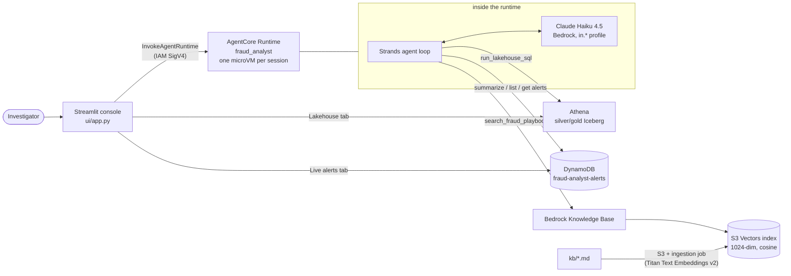

# Phase 5: The AI fraud analyst (Strands agent on Bedrock AgentCore, with a Knowledge Base on S3 Vectors)

Phases 2–4 produce a lot of data: live alerts in DynamoDB, history in the lakehouse, and a
playbook that says what to do about each kind of fraud. An investigator shouldn't need to know
DynamoDB key design or write Trino SQL to use it. This phase adds an **AI analyst**: you ask
"which payer had the most alerts today and why?" in plain English. The agent decides which data
to look at, runs the queries itself, reads the playbook, and answers with numbers and a next
step.

## What was built



| Piece | Where |
| --- | --- |
| Agent code (tools, prompt, AgentCore entrypoint) | [`src/analyst/`](../../src/analyst/) |
| Packaging, CLI, client, evals | [`agent/`](../../agent/) |
| Playbook documents (the knowledge base) | [`kb/`](../../kb/) |
| Infrastructure | [`infra/stacks/analyst_stack.py`](../../infra/stacks/analyst_stack.py) (stack `FraudAnalyst`) |
| Web console | [`ui/app.py`](../../ui/app.py), [`ui/data.py`](../../ui/data.py) |

### What happens when you ask a question

Question: *"Explain the most recent critical alert and what I should do next."*

1. The UI calls **`InvokeAgentRuntime`** with your question and a session id. The call is signed
   with your IAM credentials, like any AWS API call.
2. AgentCore routes the session to its own **microVM**. A new session gets a new microVM, which
   starts our code (`python main.py`). A follow-up in the same session reuses it, so the agent
   remembers the conversation.
3. The **Strands** agent sends Claude the question, the system prompt
   ([`prompt.py`](../../src/analyst/prompt.py)) and the descriptions of 7 tools.
4. Claude replies "call `get_recent_alerts(min_score=0.95, limit=1)`". Strands runs that Python
   function (a DynamoDB query on the `by_day` index) and sends the result back.
5. Claude calls `get_alert_details(txn_id)` to get the 15 model features and the rule reasons,
   then `search_fraud_playbook("new device high value triage")`. The knowledge base embeds the
   query, finds the nearest playbook chunks in S3 Vectors, and returns their text.
6. With all of that in context, Claude writes the answer. The response includes the answer, the
   list of tool calls (shown under **"How I got this"** in the UI), token usage and latency.

A typical answer takes 3–13 seconds, uses 1–3 tool calls and 5–14k input tokens.

## The AWS services and concepts, explained

### Amazon Bedrock and Claude
Bedrock is AWS's managed API for foundation models: you pay per token and there is nothing to
host. We use **Claude Haiku 4.5** through the `in.anthropic.claude-haiku-4-5-20251001-v1:0`
**cross-region inference profile**. An inference profile is a model id that Bedrock may route to
any region in a group (`in.` = the India regions), which gives more capacity than a single region.
Strands calls the **Converse** API, one request/response format for all models.

**Why Haiku and not a bigger model?** We tried the newest Claude models first:
`claude-sonnet-5` and `claude-haiku-5-5` return *"not available for this account"* on this
Free-plan account. `global.anthropic.claude-sonnet-4-6` works, so we compared it with Haiku 4.5 on
the same questions:
- Both gave correct numbers.
- Sonnet was about 2x slower (9–15 s), about 3x the price, and routes `global.`: the request can
  be processed in any commercial region, not only India.
- Haiku made one judgment slip (it called a 0.94 score "critical", while the runbook says
  ≥ 0.95). The fix was to compute severity in code rather than switch models (see "Making the
  agent reliable" below).

So the default stays Haiku 4.5. To switch, run
`cdk deploy FraudAnalyst -c analystModelId=global.anthropic.claude-sonnet-4-6`.

### Strands Agents (open-source SDK)
[Strands](https://strandsagents.com) runs the **agent loop**:
1. send messages and tool specs to the model;
2. if the model asks for a tool, run it and append the result;
3. repeat until the model answers.

A tool is a plain Python function with a `@tool` decorator. Its docstring becomes the
description the model reads, so those docstrings ([`tools.py`](../../src/analyst/tools.py)) are
effectively part of the prompt. The tools:

| Tool | Backed by | Used for |
| --- | --- | --- |
| `summarize_todays_alerts` | DynamoDB `by_day` query, counted in Python | "how many", "which payer has the most", "what's happening today" |
| `get_recent_alerts` | DynamoDB `by_day` (newest first) | "latest alerts", "show critical alerts" |
| `get_payer_alerts` | DynamoDB `by_payer` | one payer's alerts |
| `get_alert_details` | DynamoDB `GetItem` | why one transaction was flagged (features and reasons) |
| `run_lakehouse_sql` | Athena (workgroup `fraud-analyst`) | history, trends, rates, rankings |
| `list_lakehouse_tables` | Glue Data Catalog | exact column names when unsure |
| `search_fraud_playbook` | Bedrock KB `Retrieve` | definitions, policies, next actions |

### Amazon Bedrock AgentCore Runtime
A serverless host made for agents:
- Each **session** runs in its own isolated **microVM**, with up to 8 hours of lifetime (we set 1
  hour max and a 15-minute idle timeout).
- Your code only has to serve `GET /ping` and `POST /invocations` on port 8080. The
  `bedrock-agentcore` SDK's `BedrockAgentCoreApp` does that for you
  ([`runtime.py`](../../src/analyst/runtime.py)).
- **Direct code deployment:** instead of building a Docker image, you upload a **zip** to S3 and
  name the entry point (`main.py`) and runtime (`PYTHON_3_12`). This VM has no Docker, and a zip
  is simpler anyway.
- AgentCore runs on **arm64 (Graviton)**, so `python -m agent package` downloads the arm64 builds
  of every dependency (`pip --platform manylinux2014_aarch64 --only-binary=:all:`). The result is
  a 30 MB zip with about 4,200 files.
- The zip is **reproducible** (fixed timestamps): if nothing changed, CDK sees the same hash and
  doesn't redeploy.
- CDK uploads the zip as an asset and creates `AWS::BedrockAgentCore::Runtime`. Every change
  creates a new **runtime version**; the `DEFAULT` endpoint always points at the latest.
- **Billing:** per second of CPU actually used, plus memory while the session is alive. Waiting
  for Claude or Athena (I/O wait) isn't billed as CPU. Nothing is billed when nobody is asking
  questions.

### Bedrock Knowledge Bases (RAG) and S3 Vectors
**Retrieval-Augmented Generation (RAG)** means: find the relevant passages from your own
documents, then give them to the model with the question. How it works here:
1. The four markdown files in `kb/` are uploaded to `s3://<artifacts>/kb/` by a CDK
   `BucketDeployment`. They cover fraud patterns, the triage runbook, the model card and the data
   dictionary, written for a fictional company "PaySetu".
2. An **ingestion job** (`python -m agent ingest-kb`) splits them into ~300-token chunks with 15%
   overlap and turns each chunk into a 1,024-number **embedding** with **Titan Text Embeddings
   v2**. It stores the embeddings in an **S3 Vectors** index.
3. At question time, `Retrieve` embeds the query and returns the closest chunks by cosine
   similarity.

**S3 Vectors** is S3's native vector storage: you pay for storage and queries, with no cluster.
The usual alternative, **OpenSearch Serverless**, costs at least ~$175/month even in its smallest
dev/test setup (1 OCU around the clock), which would use the whole budget in under a month. The
index declares `AMAZON_BEDROCK_TEXT` and `AMAZON_BEDROCK_METADATA` as **non-filterable** metadata.
Bedrock stores the chunk text there, and filterable metadata is limited to 2 KB per vector.

### Calling the agent securely
The runtime uses AgentCore's default **IAM (SigV4) inbound auth**: only principals with
`bedrock-agentcore:InvokeAgentRuntime` permission can call it. The runtime's own **execution role**
(`fraud-analyst-agentcore-runtime`) allows only:
- invoking Claude models and retrieving from this one knowledge base;
- Athena queries in the `fraud-analyst` workgroup;
- **read-only** Glue catalog, lake bucket and DynamoDB access (a CDK assertion test checks that no
  write actions are present);
- writing its own logs, traces and metrics.

### Streamlit
A Python library that turns a script into a web app. [`ui/app.py`](../../ui/app.py) has three tabs:
- **Ask the analyst**: chat. Each answer has a "How I got this" expander with the SQL and the tool
  inputs. The sidebar switches between the deployed AgentCore runtime and running the same agent
  locally.
- **Live alerts**: KPIs, alerts by reason and by city, and the newest 200 alerts. It refreshes
  every 10 seconds using `st.fragment(run_every="10s")`.
- **Lakehouse**: the Athena saved queries or your own read-only SQL, with data scanned and cost.

## Making the agent reliable (lessons from testing)

Language models are good at choosing what to look up and at explaining. They are less reliable at
counting rows or applying thresholds. Each problem we saw in testing, and its fix:

| Problem seen | Fix |
| --- | --- |
| Asked "how many alerts today?", the model received 100 rows and answered "100+" | `summarize_todays_alerts` counts in Python and returns exact totals (and uses 10x fewer tokens) |
| City ranking used raw `gold_fraud_daily` rows (city × category × day), not per-city totals | The prompt explains the table grain and says to SUM and GROUP BY city (or use `v_fraud_by_city`) |
| It called a 0.94 score "critical" (the runbook says ≥ 0.95) | Tools add `severity` and `event_time_ist`, computed in code; the prompt says to use them as given |
| Risk of the model writing `DELETE`/`DROP` | `is_read_only()` rejects anything but one SELECT/WITH; the Athena workgroup caps scans at 1 GB; the IAM role can't write |
| A wrong column name in SQL | Tools return errors as data, so the model reads the Athena error and fixes the query (up to 3 tries) |

To keep it that way, `python -m agent eval` asks 5 questions and checks the answers against ground
truth it computes itself from DynamoDB and Athena:
- today's count and top payer;
- the model's true and false positives;
- the top city by alert rate;
- a playbook action;
- a refusal to delete data.

## Free plan check

Before building, each service was probed with real create → use → delete calls on this account:

| Service | Probe | Result |
| --- | --- | --- |
| AgentCore Runtime | a 20-line stdlib HTTP server as a code zip; create, invoke, delete | READY in ~10 s, invoke returned 200 |
| S3 Vectors | create bucket and index, put, query, delete | OK |
| Bedrock Knowledge Base | KB on S3 Vectors with Titan v2, ingest 1 doc, retrieve | ingestion COMPLETE, top hit score 0.68 |
| Claude models | Converse with each inference profile | Haiku 4.5 (`in.`, `global.`), Sonnet 4.5/4.6 (`global.`) work; Sonnet 5 and Haiku 5.5 not available for this account |

## What we verified (Oct 22, 2026)

| Check | Result |
| --- | --- |
| `cdk deploy FraudAnalyst` | about 100 s; runtime `fraud_analyst` READY |
| KB ingestion | 4 documents scanned, 4 indexed, 0 failed |
| End to end | 3,852 generated payments → 529 alerts in silver (8,392 payments total). The agent answered "529 out of 8,392 flagged" plus per-pattern catch rates, matching a direct Athena query |
| Multi-turn | "Top 3 riskiest payers?" then "For the first one, show their latest 3 alerts": the follow-up used the right payer (same session, same microVM) |
| `python -m agent eval` on the deployed runtime | **5/5 passed**, 2–5 s per answer |
| Streamlit console | all three tabs work against live data (screenshots in the final README) |
| Tests | `pytest`: 75 passed (tools on moto DynamoDB, runtime session handling, zip packaging, UI helpers, CDK assertions) |

## Cost of this phase

| Item | Price | What it cost here |
| --- | --- | --- |
| Claude Haiku 4.5 | $1 per million input tokens, $5 per million output tokens | ~$0.01 per question (5–14k in, 0.4–0.9k out) |
| AgentCore Runtime | ~$0.0895 per vCPU-hour (active CPU only) + ~$0.00945 per GB-hour | a fraction of a cent per question; $0 idle |
| Knowledge base ingestion (Titan v2) | $0.00002 per 1k tokens | < $0.01 for the 4 docs |
| S3 Vectors | storage ~$0.06/GB-month, queries per API call and data processed | < $0.01/month at this size |
| Athena queries from the agent | $5/TB scanned, 10 MB minimum | ~$0.00005 per query |
| CDK BucketDeployment Lambda | runs only during deploys | ~$0 |

**Idle cost: about $0/day.** Nothing in this stack runs unless someone asks a question. Testing
this phase (about 30 questions, roughly 400k input tokens) cost about $0.40 in Claude tokens.

## Try it yourself

```bash
source .venv/bin/activate
pip install -r requirements-dev.txt
python -m pytest -q tests/test_analyst_tools.py tests/test_analyst_runtime.py tests/test_analyst_stack.py tests/test_ui_data.py

python -m agent package                     # build/analyst_runtime.zip (arm64 wheels, ~30 MB)
cdk deploy FraudAnalyst                     # KB, S3 Vectors, AgentCore runtime
python -m agent ingest-kb                   # index kb/*.md (run again after editing the docs)

python -m agent ask "How many fraud alerts were raised today, and which payer had the most?"
python -m agent ask "What is a velocity burst and how do we respond to one?"
python -m agent chat                        # a conversation; context is kept between questions
python -m agent ask --local "..."           # same agent, run on your machine (good for debugging)
python -m agent eval                        # 5 answer-quality checks against ground truth

streamlit run ui/app.py                     # http://localhost:8501
```

To see the agent react to new data, run some traffic first:
`python -m generator --fraud-rate 0.02 live --url auto --duration 300`. The Live alerts tab and
`summarize_todays_alerts` see it within seconds. For the lakehouse, run `python -m lakehouse load`
and `python -m lakehouse glue`.

Good questions to try:
- "Which 5 cities have the highest alert rate, and how much money is at risk there?"
- "Show payer U00080's latest alerts and tell me whether to block them."
- "How did each simulated fraud pattern do: caught vs missed?"
- "What hour of the day (IST) has the most alerts?"
- "What are the limitations of the model?" (answered from the model card)

## What to look at in the AWS console

- **Amazon Bedrock → AgentCore → Agent runtime → fraud_analyst**:
  - *Versions*: one per deploy. The `DEFAULT` endpoint points at the latest.
  - The runtime role and environment variables.
- **CloudWatch → Log groups → `/aws/bedrock-agentcore/runtimes/fraud_analyst-…-DEFAULT`**: one
  `answered` line per question, with latency, tools used and tokens.
- **Amazon Bedrock → Knowledge Bases → fraud-analyst-playbook**:
  - the data source and its sync history;
  - the *Test knowledge base* panel: ask "what is p2p fanout?" and look at the retrieved chunks.
- **S3 → Vector buckets → fraud-analyst-kb-…** → index `playbook` (1024 dimensions, cosine).
- **Amazon Bedrock → Model catalog**: model access, and the inference profiles under *Cross-region
  inference*.
- **IAM → Roles → fraud-analyst-agentcore-runtime**: what the agent is allowed to do (and not do).
- **Athena → Recent queries** (workgroup `fraud-analyst`): every SQL statement the agent ran.

## Teardown

```bash
cdk destroy FraudAnalyst    # runtime, KB, vector index and bucket, roles
```

The runtime's log group is created by AgentCore itself, not by CloudFormation. The stack's
`LogRetention` resource sets it to expire logs after 7 days and deletes it on `cdk destroy`.
