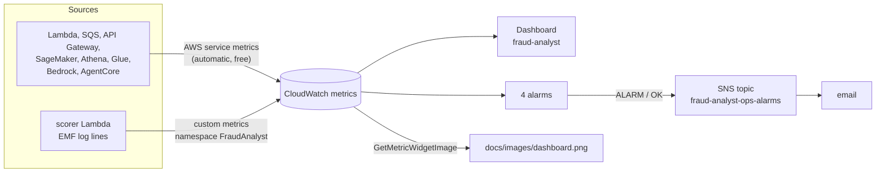

# Phase 6: Polish (dashboard, alarms, diagram, cost report, CI, teardown)

Phases 1–5 built a working system. This phase makes it something you can **operate** and
**show**:
- one dashboard that follows a payment through every stage;
- alarms that email you when something needs a human;
- an architecture diagram generated from text;
- a cost report from Cost Explorer;
- tests that run on every pull request;
- a single command that deletes everything.

## What was built

| Piece | Where |
| --- | --- |
| CloudWatch dashboard `fraud-analyst`, 4 alarms, ops SNS topic | [`infra/stacks/monitoring_stack.py`](../../infra/stacks/monitoring_stack.py) (stack `FraudMonitoring`) |
| Architecture diagram source and PNG | [`docs/architecture.mmd`](../architecture.mmd), [`docs/images/architecture.png`](../images/architecture.png) |
| Dashboard snapshot without the console | [`scripts/dashboard_snapshot.py`](../../scripts/dashboard_snapshot.py) |
| Cost Explorer report | [`scripts/cost_report.py`](../../scripts/cost_report.py) |
| Teardown | [`scripts/teardown.py`](../../scripts/teardown.py) |
| CI (pytest on every push and PR) | [`.github/workflows/ci.yml`](../../.github/workflows/ci.yml) |
| CDK assertion tests for the monitoring stack | [`tests/test_monitoring_stack.py`](../../tests/test_monitoring_stack.py) |
| The project README (diagram, results, demo script, cost, teardown) | [`README.md`](../../README.md) |

### How monitoring data flows



Most numbers on the dashboard are **AWS service metrics**: every Lambda, queue, API, endpoint
and model publishes them automatically, at no cost. A few are **custom metrics** the scorer
publishes in phase 2: `TransactionsScored`, `AlertsRaised`, `EventToScoreLatencyMs`,
`ModelFallbacks` and others. It writes them as specially shaped JSON log lines (the *embedded
metric format*, EMF), and CloudWatch turns those lines into metrics.

## The services and concepts, explained

### CloudWatch dashboards

A dashboard is a saved grid of widgets. Each widget is a graph, a number or text, defined in JSON.
CDK writes that JSON for us: `cw.GraphWidget(left=[metric, ...])`. Ours has one row per stage of
the pipeline, top to bottom:

1. **KPIs**: payments scored, alerts raised, alert emails, and model fallbacks, as totals and per
   minute.
2. **Latency**: event → score p50/p95/max, API requests and errors, and Lambda duration.
3. **Queues**: depth, age of the oldest message, and the dead-letter queues (these should stay 0).
4. **Lambda health and the model**: errors and throttles, SageMaker invocations, 4xx/5xx and
   fallbacks, model latency, and cold starts.
5. **Lakehouse**: loader runs and errors, Athena bytes scanned, and Glue tasks.
6. **AI analyst**: Bedrock tokens for the analyst's model, plus AgentCore invocations, errors and
   latency.
7. **Alarm status**.

**Statistics.** A *statistic* says how to combine the data points in each period. `Sum` counts
events, and `p95` means "95% of payments were faster than this". `Maximum` is the worst case.
Latency needs percentiles: an average hides the slow tail.

**SEARCH expressions.** AgentCore publishes its metrics with a `Resource` dimension that contains
the runtime ARN, which ends in a random suffix. Rather than hard-code it, the widget uses a search
expression:

```
SEARCH('{AWS/Bedrock-AgentCore,Name,Operation,Resource} MetricName="Invocations" Name="fraud_analyst::DEFAULT"', 'Sum', 300)
```

It finds every metric in that namespace whose `Name` dimension is our endpoint, whatever the ARN.

The dashboard's default time range is 3 hours. Use the time picker (top right) to zoom in on a
demo.

**Cost:** the first 3 dashboards per account are free, then $3 per dashboard per month.

### CloudWatch alarms

An alarm watches one metric and has three states: `OK`, `ALARM` and `INSUFFICIENT_DATA`. Each
period it compares the metric with a threshold, and after `evaluation_periods` breaching periods
in a row it moves to `ALARM` and runs its actions (here: publish to the ops SNS topic). When the
metric recovers it goes back to `OK`, and that sends an email too.

| Alarm | Fires when | Why it matters |
| --- | --- | --- |
| `fraud-analyst-payments-dlq-not-empty` | any message in the payments DLQ (5-min max ≥ 1) | a payment failed scoring 3 times; it was never checked for fraud |
| `fraud-analyst-lake-dlq-not-empty` | any message in the lake buffer DLQ | some scored payments won't reach the lakehouse |
| `fraud-analyst-scorer-errors` | scorer Lambda errors ≥ 1 in 5 min | a bug or bad input; SQS retries, then the DLQ |
| `fraud-analyst-model-fallbacks` | ≥ 10 rule-scored payments per 5 min, 2 periods in a row | the SageMaker endpoint is failing; we're on the weaker rules |

**Treat missing data as not breaching.** With no traffic there are no data points. Without this
setting the alarms would sit in `INSUFFICIENT_DATA` all night, and some would fire when traffic
returned. The model-fallback alarm needs **2 periods in a row** because a serverless endpoint
sometimes fails a few calls while it scales up, and the scorer retries those. One bad minute isn't
worth an email.

**Two SNS topics.** Fraud alerts (phase 2) are for investigators. Alarms go to a separate ops
topic, `fraud-analyst-ops-alarms`, so "the pipeline is broken" and "this payment looks like fraud"
never land in the same inbox. In a team, each topic would go to a different group or to a pager.

> **Confirm the ops subscription.** SNS sends a "Subscription Confirmation" email to
> sahilcsgo69@gmail.com for `fraud-analyst-ops-alarms`. Until you click **Confirm subscription**,
> alarm emails are silently dropped. (The fraud-alert topic from phase 2 needs its own
> confirmation.)

**Cost:** standard alarms are $0.10 per alarm per month after the first 10, so our 4 are free.

### Rendering the dashboard without the console: `GetMetricWidgetImage`

CloudWatch can render any widget's JSON as a PNG through an API call, which is handy for reports
and READMEs. `scripts/dashboard_snapshot.py`:
1. reads the dashboard's JSON (`GetDashboard`);
2. renders each graph widget (`GetMetricWidgetImage`);
3. tiles the images into `docs/images/dashboard.png` with Pillow.

It skips the text, single-value and alarm-status widgets, which the image API can't draw. Each
call is billed like a `GetMetricData` request, a fraction of a cent for the whole dashboard.

### The architecture diagram: mermaid

[Mermaid](https://mermaid.js.org) draws diagrams from text, so the diagram lives in git, changes in
pull requests, and GitHub renders it in markdown. [`docs/architecture.mmd`](../architecture.mmd)
is the source; the same text is in the README inside a `mermaid` block. To export the PNG
(Node.js and Chrome needed):

```bash
npx -y -p @mermaid-js/mermaid-cli@11 mmdc -i docs/architecture.mmd -o docs/images/architecture.png -b white -w 1500 -s 2
```

`-s 2` renders at 2x scale for a sharp image. If Chrome can't start (on a server or in a
container), pass `-p puppeteer.json` with
`{"args": ["--no-sandbox", "--disable-gpu"]}`.

Two things that tripped us up:
- edge labels containing dots must use the `-->|model.tar.gz|` form, not `-- model.tar.gz -->`;
- arrows that cross between subgraphs make mermaid ignore each subgraph's `direction`, so the
  diagram keeps cross-links to a minimum.

### Cost Explorer and the Free plan credits

**Cost Explorer** is AWS's billing database. You can group spend by service, region, day, tag and
more. `scripts/cost_report.py` calls `GetCostAndUsage`:
- **grouped by service and region**, so the pre-existing EC2 instance in another region is listed
  separately from this project;
- **excluding the `Credit` and `Refund` record types**, so you see what the usage is worth, not $0
  after credits;
- **daily totals**, so you can spot a runaway resource by a sudden jump.

It also reads the Free plan credit balance and expiry date (`freetier:GetAccountPlanState`).

Two things to know:
- **Cost Explorer lags by up to 24 hours.** Usage from today usually shows up tomorrow, so on the
  day everything was built it showed $0.00 for this project. The README pairs the Cost Explorer
  snapshot with an estimate from usage metrics (tokens, invocations, DPU-hours) × list price.
- Each Cost Explorer API request costs **$0.01**. The report makes 3 or 4.

**Budgets** (phase 1) are the safety net. `fraud-analyst-total-spend` emails at $40, $80 and
$110 of actual spend, counted *before* credits, so it fires even though credits pay the bill.

### CI with GitHub Actions

[`.github/workflows/ci.yml`](../../.github/workflows/ci.yml) runs the full pytest suite on every
push to `main` and every pull request:
- it sets up Python 3.12, Node 22 and Java 17. CDK synthesis runs on Node (the Python CDK
  library is a wrapper over the JavaScript one), and the Glue job tests run Spark locally on Java;
- `pip install -r requirements-dev.txt`, then `python -m pytest -q`.

The tests never call AWS. Handlers run against **moto** (an in-memory fake of DynamoDB, SQS and
SNS), the Athena, Glue and Bedrock clients are small fakes, and the stacks are checked with **CDK
assertions** on the synthesized CloudFormation. So CI needs no AWS credentials, and a pull request
can't touch the account.

### Teardown

`cdk destroy --all` deletes every stack in reverse dependency order. Our buckets use
`RemovalPolicy.DESTROY` with `auto_delete_objects=True`, so they're emptied first. The Glue
database is deleted with its tables. That still leaves a few things behind, which
`scripts/teardown.py` handles:

| Leftover | Why it survives | Script |
| --- | --- | --- |
| Log groups for the SageMaker endpoint, the AgentCore runtime (if retention never ran) and CDK helper Lambdas | AWS services create them on first use, outside CloudFormation | deleted by default |
| `/aws-glue/jobs/*`, `/aws/sagemaker/ProcessingJobs` | shared by every Glue job and processing job in the account | `--shared-logs` |
| `CDKToolkit` stack, its asset bucket (versioned) and ECR repository | created by `cdk bootstrap`; the bucket and repository are retained when the stack is deleted | `--bootstrap` |

## What we verified (Oct 22, 2026)

| Check | Result |
| --- | --- |
| `cdk deploy FraudMonitoring` | dashboard `fraud-analyst`, 4 alarms in `OK`, ops topic with an email subscription (pending confirmation) |
| Dashboard with live data | 6-minute generator run (4 payments/s, 2% fraud) plus `python -m agent eval` → every row populated, including AgentCore and Bedrock tokens; snapshot in [`docs/images/dashboard.png`](../images/dashboard.png) |
| End to end, all phases | 9,926 payments in silver, 586 alerts. Model precision **0.981**, recall **0.907** vs simulator ground truth; event → score p50 **1.2 s**, p95 **1.9 s** |
| AI analyst | `python -m agent eval` 5/5 on the deployed runtime |
| `python scripts/teardown.py --dry-run --bootstrap --shared-logs` | lists the 6 project stacks, 12 log groups and the CDKToolkit bucket and repository |
| `python scripts/cost_report.py` | project $0.00 (Cost Explorer lag), $5.17 in another region from a pre-existing EC2 instance, credits $174.73, plan expires 2026-10-30 |
| Tests | `pytest`: **80 passed** |

## Cost of this phase

| Item | Cost |
| --- | --- |
| Dashboard (first 3 free) and 4 alarms (first 10 free) | $0 |
| Dashboard snapshot (16 `GetMetricWidgetImage` calls) | < $0.001 |
| One more Glue run for fresh numbers (0.048 DPU-hours) | ~$0.02 |
| Verification traffic and evals (Claude tokens) | ~$0.05 |
| Cost Explorer API (a few reports) | ~$0.05 |

**Whole project so far: about $0.60** of usage. See the README's [Cost](../../README.md#cost)
section for the breakdown.

## Try it yourself

```bash
source .venv/bin/activate
python -m pytest -q tests/test_monitoring_stack.py
python -m pytest -q                                   # everything (80 tests)

cdk deploy FraudMonitoring

# Make the dashboard interesting
python -m generator --fraud-rate 0.02 live --duration 300
python -m agent eval

python scripts/dashboard_snapshot.py --hours 3        # -> docs/images/dashboard.png
python scripts/cost_report.py                          # Cost Explorer, by service and region
python scripts/cost_report.py --start 2026-10-01 --end 2026-10-31

# Test an alarm: force one into ALARM for a moment (it re-evaluates on the next period)
aws cloudwatch set-alarm-state --alarm-name fraud-analyst-scorer-errors \
  --state-value ALARM --state-reason "testing the ops email"
aws cloudwatch describe-alarms --alarm-name-prefix fraud-analyst \
  --query 'MetricAlarms[].[AlarmName,StateValue]' --output table

python scripts/teardown.py --dry-run                   # what teardown would delete
```

## What to look at in the AWS console

- **CloudWatch → Dashboards → fraud-analyst**: change the time range to the last 15 minutes while
  the generator runs. Click any graph's ⋮ menu → *View in metrics* to see the query behind it.
- **CloudWatch → Alarms → All alarms**: the 4 `fraud-analyst-*` alarms, their history (state
  changes and the emails they sent), and the threshold line on each graph.
- **CloudWatch → Metrics → All metrics → FraudAnalyst → Service**: the custom metrics the scorer
  publishes.
- **SNS → Topics → fraud-analyst-ops-alarms → Subscriptions**: the status shows *Confirmed* once
  you've clicked the link.
- **Billing and Cost Management → Cost Explorer**: group by *Service*, then by *Region*;
  set *Charge type* to exclude *Credit* to see what the usage is worth.
- **Billing and Cost Management → Budgets → fraud-analyst-total-spend**: spend so far against
  the $40/$80/$110 alerts.
- **Billing and Cost Management → Free plan** (or the Free tier page): credits remaining and the
  plan's end date.
- **GitHub → Actions**: the CI run for each pull request.

## Before October 30, 2026

The account closes when the Free plan ends, and everything in it goes with it. Checklist:

- [x] Screenshots of the console and dashboard in `docs/images/` (taken Oct 22)
- [x] Cost Explorer numbers and the usage estimate in the README
- [x] README note that the live stack won't survive past Oct 30
- [x] Fraud-alert email subscription confirmed (phase 2)
- [ ] Confirm the ops alarm subscription (`fraud-analyst-ops-alarms` is still *PendingConfirmation*)
- [ ] Rerun `python scripts/cost_report.py` a day or two later for the final Cost Explorer numbers
- [ ] Run `python scripts/teardown.py --bootstrap` when you're done demoing (optional: the
      account closure removes everything anyway, and idle cost is about $0.01/day)

## What's deployed now, and what it costs idle

| Stack | What's in it | Idle cost |
| --- | --- | --- |
| `CDKToolkit` | CDK asset bucket and roles | ~$0 (a few MB of S3) |
| `FraudFoundation` | 3 S3 buckets, Glue database, budget | ~$0 (a few MB of S3; budgets are free) |
| `FraudMl` | SageMaker model and **serverless** endpoint | $0 (billed per request) |
| `FraudStreaming` | HTTP API, 2 Lambdas, SQS FIFO + DLQ, 2 DynamoDB tables, SNS | ~$0 (on-demand; the scorer's SQS long-polling is within the free tier) |
| `FraudLakehouse` | SQS buffer + DLQ, loader Lambda (every 5 min), Glue job, Athena workgroup | ~$0.003/day (loader polls) |
| `FraudAnalyst` | AgentCore runtime, Knowledge Base, S3 Vectors index | $0 (billed per request) |
| `FraudMonitoring` | dashboard, 4 alarms, ops topic | $0 (within the free tier) |

**Total idle: about $0.01/day or less.** Nothing is always-on: no Kinesis shards, MSK brokers,
OpenSearch clusters, provisioned endpoints or EMR clusters.
